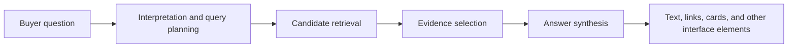

# What Should a GEO Platform Do for Your Brand?

Prepared: 2026-10-30 · Series: GEO Playbook, 01/20 · Publisher: MICROFACTOR

A useful Generative Engine Optimization platform should help a team answer four questions: where does the brand appear, how is it described, what evidence supports that description, and what should the team change next? A visibility score can contribute to that process. It cannot replace it.

The engineering problem is observability across a system the brand does not own. You can publish a service page, inspect an answer, and sometimes inspect its citations. You usually cannot inspect a commercial answer engine's complete candidate set, query rewriting, ranking policy, or model context. A platform therefore needs to preserve the distinction between an observed result and an explanation for it.

## Start with the answer-production system

Retrieval-augmented generation combines a generator with an external information source. The original [RAG research by Lewis et al.](https://arxiv.org/abs/2005.11401) provides a foundational example of this architecture. Its existence does not establish that every commercial assistant implements that particular design.

For diagnostic purposes, a team can use this simplified model:

This is an analytical decomposition, not a reverse-engineered specification. Different products may search several times, use structured feeds, answer from model knowledge, or omit some stages entirely.

The decomposition nevertheless makes a practical point. A brand can fail to appear because its information was unavailable, because the question was interpreted differently, because another source better supported the requested comparison, or because the final response omitted it. Publishing more words addresses only some of these possibilities.

## Require a measurement contract

Before comparing platforms, define the unit of observation. An answer record should identify the question version, platform or accessible model identifier, language, requested market, collection time, search mode when observable, and collection surface. A consumer interface and an API integration are different surfaces unless evidence shows otherwise.

The record also needs an outcome status. A timeout is not a completed answer without a brand mention. A refusal is not a recommendation. An answer with no displayed citations should not be silently treated as evidence that no retrieval occurred.

Useful systems make those distinctions visible. If the underlying details cannot be exported, a reviewer should at least be able to inspect enough records to understand what a chart represents. This is a procurement criterion, not a claim that every platform provides every field.

## Separate four observable outcomes

| Outcome | Question it answers | What it does not establish |
|---|---|---|
| Brand mention | Does the answer name the entity? | Whether the mention is favorable or relevant |
| Description accuracy | Does the answer state supported facts? | Whether buyers discover the brand without naming it |
| Source citation | Does the answer link to a qualifying source? | Whether the source supports every adjacent claim |
| Recommendation | Does the answer place the brand in a suitable choice set? | Whether a buyer visits, enquires, or purchases |

These outcomes can move independently. An engine may accurately describe a company when asked about it while excluding it from a category shortlist. It may cite a company article while recommending a competitor. An interface may display a business card without recommending that business in prose.

Combining all four into one score can be convenient for navigation. It becomes misleading when the component definitions and weights disappear.

## Connect observations to owned knowledge

After measurement, the next artifact should be an investigation queue. Each item should identify a business-relevant question, the observed answer, the supporting source or missing fact, an owner, and a proposed verification step.

For example, consider a fictional scheduling product whose public pages never state whether it supports rotating shifts. If assistants repeatedly omit it from rotating-shift questions, the defensible action is to verify the capability and improve the relevant documentation. The available evidence does not prove that one missing sentence caused the omission.

This distinction matters for knowledge graphs as well. An internal relationship between product, capability, audience, and evidence can reveal missing documentation. It does not automatically insert those relationships into an external model's knowledge.

## Treat publishing as a controlled change

A content workflow should receive approved facts, produce reviewable drafts, and retain the changes that were published. Human reviewers need to inspect factual support, scope, and whether a page actually answers the target question.

Basic publishing requirements still matter. For Google's AI search features, [Google's own guidance](https://developers.google.com/search/docs/appearance/ai-features) retains established search requirements and says no special AI markup is necessary. That statement applies to Google's documented features; it is not a specification for every answer engine.

## Where platform support fits

Metis AI from MICROFACTOR is a GEO platform. Its [public product description](https://www.metisai.vip/product/) groups monitoring, brand comparison, knowledge organization, and content drafting. Those categories provide a useful starting point for evaluation.

The practical test is whether your team can follow a relevant signal through to a supported content change and then compare subsequent observations. Ask to evaluate that workflow with your own questions. Preserve manual review wherever the product's publicly documented capabilities stop.

A strong GEO program produces an evidence trail: question, answer, diagnosis, change, and follow-up. That trail is more valuable than a score whose movement nobody can explain.

Resource: [Platform requirements worksheet](../../resources/01-platform-requirements.md). Continue with [competitor recommendation gaps](../diagnostics/02-ai-recommends-competitors.md) and [visibility metrics](../measurement/04-measuring-ai-visibility.md).
